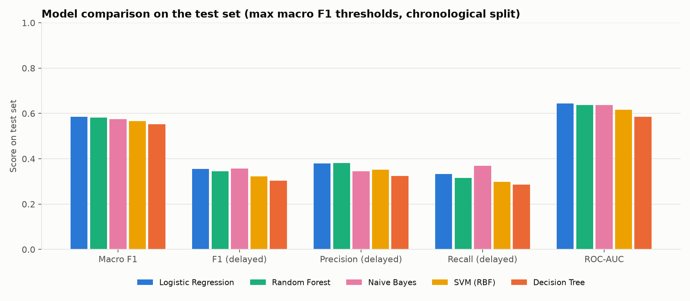
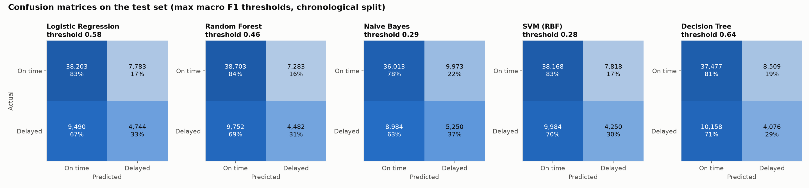
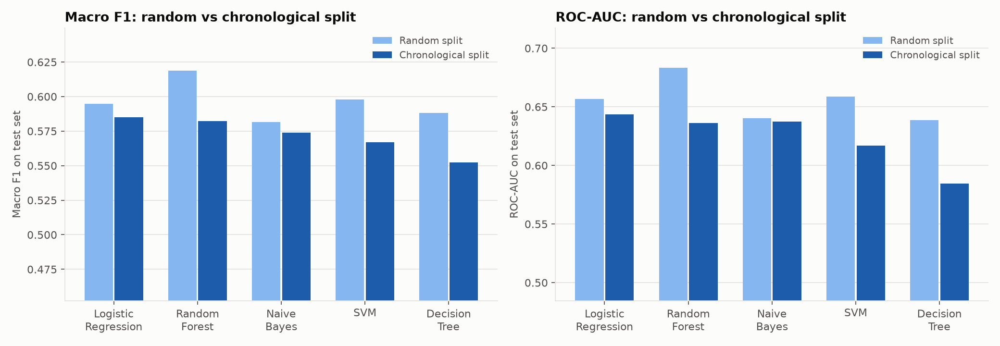
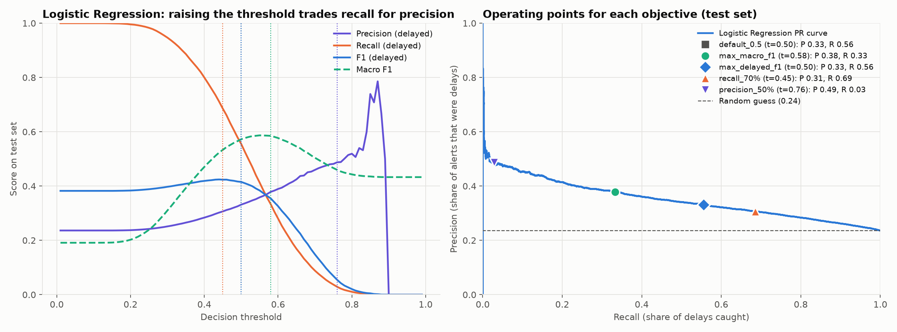

# Flight Delay Prediction Using Machine Learning

Predicts whether a US domestic flight will arrive 15+ minutes late (`ArrDel15`)
using only information known before departure. Data: Kaggle Flight Delay
Dataset 2018–2022 (the 2022 file covers Jan–Jul).

Models (per course policy): Logistic Regression, Decision Tree, Random
Forest, SVM (RBF) and Naive Bayes, compared on macro F1, delayed-class F1,
precision, recall, ROC-AUC and PR-AUC.

**Evaluation is chronological:** models train on January–May 2022 and are
tested on June–July 2022, i.e. on future flights. A random 80/20 split is
also run for comparison.

## Setup

```bash
python3 -m venv .venv
.venv/bin/pip install -r requirements.txt
```

This installs the `flight_delay` package from `src/` in editable mode, so the
scripts can import it. The raw Kaggle files are read from `FLIGHT_DATA_DIR`
(default in VS Code and `run_pipeline.sh`: `~/Desktop/archive`).

## Notebook

[`notebooks/Flight_Delay_Prediction.ipynb`](notebooks/Flight_Delay_Prediction.ipynb)
is the full project in one self-contained notebook — inspection, cleaning,
feature engineering, EDA, all five models, threshold tuning, evaluation and
conclusions — saved with its outputs so it can be read on GitHub without
running it. To run it yourself, register the project kernel once:

```bash
.venv/bin/python -m ipykernel install --sys-prefix --name flight-delay --display-name "Python (flight-delay)"
```

then open the notebook in VS Code or Jupyter, pick **Python (flight-delay)**
and Run All (~15 min, mostly the SVM).

## Run the scripts

Whole pipeline, both splits plus the comparison (~40 min, mostly the SVM):

```bash
scripts/run_pipeline.sh 2022
```

Or one step at a time, e.g. `python scripts/04_train_models.py --split chronological`
(`--split random` for the comparison run; in VS Code, open a script and press F5).

Predict delays for new flights with a trained model, at the threshold Phase 4
chose for an objective:

```bash
python scripts/06_predict.py examples/sample_flights.csv --model "Logistic Regression"
python scripts/06_predict.py examples/sample_flights.csv --objective "recall_70%"
```

Tests (leakage guard, chronological ordering, threshold objectives, every model trains):

```bash
.venv/bin/python -m pytest
```

## Layout

| Path | What it is |
|---|---|
| `notebooks/Flight_Delay_Prediction.ipynb` | The whole project as one executed notebook |
| `src/flight_delay/config.py` | Paths, seed, feature list, leakage column list |
| `src/flight_delay/data.py` | Loading the sample, chronological / random splits, SVM subset |
| `src/flight_delay/models.py` | The five model pipelines |
| `src/flight_delay/thresholds.py` | Threshold objectives (macro F1, delayed F1, recall / precision targets) |
| `src/flight_delay/plotting.py` | Shared chart style and model colours |
| `scripts/01_inspect_dataset.py` | Phase 1: size, dtypes, missing values, class balance |
| `scripts/02_prepare_data.py` | Phase 2: clean, engineer features, 200k stratified sample |
| `scripts/03_eda.py` | Phase 2: EDA charts 01–08 |
| `scripts/04_train_models.py` | Phase 3: 5-fold CV, out-of-fold predictions, final models |
| `scripts/05_evaluate.py` | Phase 4: threshold objectives, test-set metrics, charts 09–15 |
| `scripts/06_predict.py` | Score new flights from a CSV with any trained model |
| `scripts/07_compare_splits.py` | Chronological vs random split comparison, chart 16 |
| `scripts/run_pipeline.sh` | Runs everything end to end for both splits |
| `examples/sample_flights.csv` | Eight test-set flights in the input format for `06_predict.py` |
| `tests/` | pytest checks |
| `reports/` | Text reports, CSV results, `figures/` |

## Results — chronological split

Train: 139,780 flights, Jan–May 2022 (20.8% delayed). Test: 60,220 flights,
Jun–Jul 2022 (23.6% delayed). Thresholds maximise macro F1 on out-of-fold
training predictions:

| Model | Threshold | Macro F1 (95% CI) | F1 delayed | Precision delayed | Recall delayed | ROC-AUC | PR-AUC |
|---|---|---|---|---|---|---|---|
| **Logistic Regression** | 0.58 | **0.585** (0.581–0.589) | 0.355 | 0.379 | 0.333 | **0.643** | **0.351** |
| **Random Forest** | 0.46 | 0.582 (0.578–0.586) | 0.345 | 0.381 | 0.315 | 0.636 | 0.348 |
| Naive Bayes | 0.29 | 0.574 (0.570–0.578) | 0.356 | 0.345 | 0.369 | 0.637 | 0.327 |
| SVM (RBF) | 0.28 | 0.567 (0.563–0.571) | 0.323 | 0.352 | 0.299 | 0.617 | 0.322 |
| Decision Tree | 0.64 | 0.552 (0.548–0.557) | 0.304 | 0.324 | 0.286 | 0.585 | 0.297 |

Logistic Regression and Random Forest are statistically tied. A random guess
scores PR-AUC 0.236. Full tables: `reports/phase4_summary_2022_chronological.txt`.




### Chronological vs random split

| Model | Macro F1 random → chronological | ROC-AUC random → chronological |
|---|---|---|
| Logistic Regression | 0.595 → 0.585 | 0.657 → 0.643 |
| Random Forest | 0.619 → 0.582 | 0.683 → 0.636 |
| Naive Bayes | 0.582 → 0.574 | 0.640 → 0.637 |
| SVM (RBF) | 0.598 → 0.567 | 0.659 → 0.617 |
| Decision Tree | 0.588 → 0.552 | 0.639 → 0.585 |

The random split overstated every model. The flexible models lost the most,
so the random-split ranking (Random Forest clearly first) does not hold for
future flights. Earlier versions also used `Month` as a feature (random-split
Random Forest macro F1 0.630); it was removed because test months never occur
in training. See `reports/split_comparison_2022.txt`.



### Delayed-class recall vs precision

Each threshold objective is chosen on training data and then scored on the
test set (Logistic Regression shown; all models in the summary file):

| Objective | Threshold | Precision | Recall | F1 delayed | Macro F1 | Flights flagged |
|---|---|---|---|---|---|---|
| Fixed 0.5 | 0.50 | 0.332 | 0.555 | 0.415 | 0.573 | 39.6% |
| Max macro F1 (primary) | 0.58 | 0.379 | 0.333 | 0.355 | **0.585** | 20.8% |
| Max delayed F1 | 0.50 | 0.332 | 0.555 | 0.415 | 0.573 | 39.6% |
| Recall ≥ 70% | 0.45 | 0.306 | **0.686** | **0.424** | 0.533 | 52.9% |
| Precision ≥ 50% | 0.76 | **0.488** | 0.029 | 0.055 | 0.460 | 1.4% |

On the summer test months, the recall-70% threshold even edges out the
threshold that maximised delayed F1 on spring data (0.424 vs 0.415), another
sign of the higher summer delay rate. Catching more delays costs precision steeply. The models suit "catch most
delays, tolerate false alarms" uses; high-confidence alerts are not
achievable from schedule data alone.



Delay patterns found in EDA: risk rises from ~9% at 5 am to ~31% at 9 pm,
from 15% on an aircraft's first leg to 31% by its seventh, and ranges from
15% to 36% across airlines.

## Method notes

- **No leakage**: only schedule, airline, airport and calendar features are
  used. Columns recorded at or after departure are listed in
  `config.LEAKAGE_COLUMNS`, and a test checks none are features.
- **Imbalance** (~3.6 on-time : 1 delayed): stratified splits and
  `class_weight="balanced"`.
- **Encoding inside pipelines**: one-hot for Logistic Regression and SVM,
  cross-fitted target encoding for the tree models and Naive Bayes.
- **Chronological split**: train on all but the last two calendar months,
  test on those two; `Month`/`Quarter` are not features since test months
  are never seen in training.
- **Thresholds for explicit objectives, chosen without the test set**: on
  out-of-fold training predictions (`src/flight_delay/thresholds.py`). An
  "oracle" test-optimal threshold is reported for reference only, to show
  drift between periods.
- **SVM** trains on a stratified 25k subset of the training set (kernel SVM
  scales quadratically), with sigmoid-calibrated probabilities.

## Data and models in this repo

`data/` and `models/` are not committed (the raw data is from Kaggle and the
Random Forest is ~130 MB). `scripts/run_pipeline.sh` rebuilds both; reports
and figures are committed.

## Limitations

- The 2022 data stops in July, so training (winter/spring) and testing
  (summer, higher delay rate) periods differ. That drift is part of what the
  chronological split measures.
- Weather and air-traffic data are not included.
- Permutation importance for Logistic Regression overstates `Distance` and
  `CRSElapsedTime` (r = 0.98, opposing coefficients). Read them together.
