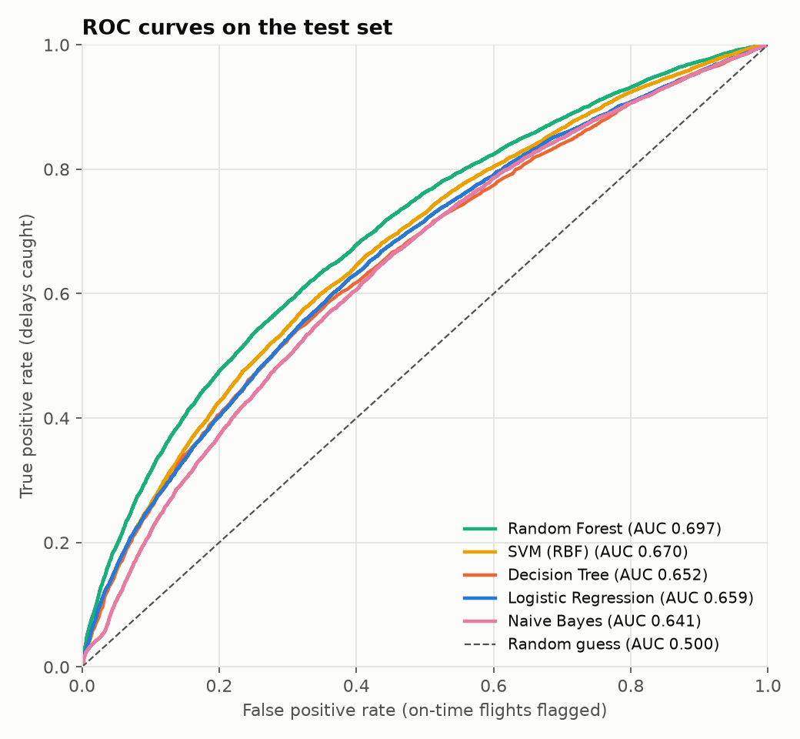
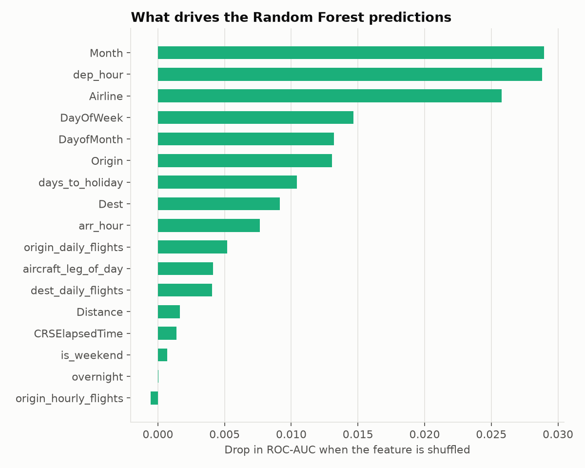

# Flight Delay Prediction Using Machine Learning

Predicts whether a US domestic flight will arrive 15+ minutes late (`ArrDel15`)
using only information known before departure. Data: Kaggle Flight Delay
Dataset 2018–2022 (the 2022 file covers Jan–Jul).

Models (per course policy): Logistic Regression, Decision Tree, Random
Forest, SVM (RBF) and Naive Bayes, compared on macro F1, delayed-class F1,
precision, recall, ROC-AUC and PR-AUC.

## Setup

```bash
python3 -m venv .venv
.venv/bin/pip install -r requirements.txt
```

This installs the `flight_delay` package from `src/` in editable mode, so the
scripts can import it. The raw Kaggle files are read from `FLIGHT_DATA_DIR`
(default in VS Code and `run_pipeline.sh`: `~/Desktop/archive`).

## Run

Whole pipeline (~20 min, mostly the SVM):

```bash
scripts/run_pipeline.sh 2022
```

Or one step at a time, e.g. `python scripts/03_eda.py --year 2022`
(in VS Code, open a script and press F5).

Predict delays for new flights with a trained model (uses the model's tuned
threshold from Phase 4):

```bash
python scripts/06_predict.py examples/sample_flights.csv --model "Random Forest"
```

Tests (leakage guard, shared split, every model trains):

```bash
.venv/bin/python -m pytest
```

## Layout

| Path | What it is |
|---|---|
| `src/flight_delay/config.py` | Paths, seed, feature list, leakage column list |
| `src/flight_delay/data.py` | Loading the sample, the shared train/test split, SVM subset |
| `src/flight_delay/models.py` | The five model pipelines |
| `src/flight_delay/plotting.py` | Shared chart style and model colours |
| `scripts/01_inspect_dataset.py` | Phase 1: size, dtypes, missing values, class balance |
| `scripts/02_prepare_data.py` | Phase 2: clean, engineer features, 200k stratified sample |
| `scripts/03_eda.py` | Phase 2: EDA charts 01–08 |
| `scripts/04_train_models.py` | Phase 3: 5-fold CV, out-of-fold predictions, final models |
| `scripts/05_evaluate.py` | Phase 4: threshold tuning, test-set metrics, charts 09–14 |
| `scripts/06_predict.py` | Score new flights from a CSV with any trained model |
| `scripts/run_pipeline.sh` | Runs steps 01–05 end to end |
| `examples/sample_flights.csv` | Eight test-set flights in the input format for `06_predict.py` |
| `tests/` | pytest checks |
| `reports/` | Text reports, CSV results, `figures/` |

## Results (2022 test set, 40,000 flights, 21.65% delayed)

Thresholds tuned for macro F1 on out-of-fold training predictions:

| Model | Threshold | Macro F1 (95% CI) | F1 delayed | Precision delayed | Recall delayed | ROC-AUC | PR-AUC |
|---|---|---|---|---|---|---|---|
| **Random Forest** | 0.46 | **0.630** (0.624–0.635) | **0.425** | 0.413 | 0.438 | **0.697** | **0.404** |
| SVM (RBF) | 0.28 | 0.607 (0.601–0.612) | 0.396 | 0.371 | 0.426 | 0.670 | 0.360 |
| Decision Tree | 0.61 | 0.598 (0.593–0.604) | 0.373 | 0.368 | 0.377 | 0.652 | 0.350 |
| Logistic Regression | 0.58 | 0.597 (0.592–0.602) | 0.378 | 0.358 | 0.401 | 0.659 | 0.356 |
| Naive Bayes | 0.30 | 0.583 (0.578–0.589) | 0.368 | 0.333 | 0.410 | 0.641 | 0.317 |

Full tables: `reports/phase4_summary_2022.txt`. A random guess scores PR-AUC 0.217.





Delay patterns found in EDA: risk rises from ~9% at 5 am to ~31% at 9 pm,
from 15% on an aircraft's first leg to 31% by its seventh, and ranges from
15% to 36% across airlines.

## Method notes

- **No leakage**: only schedule, airline, airport and calendar features are
  used. Columns recorded at or after departure are listed in
  `config.LEAKAGE_COLUMNS`, and a test checks none are features.
- **Imbalance** (~3.6 on-time : 1 delayed): stratified splits and
  `class_weight="balanced"`.
- **Encoding inside pipelines**: one-hot for Logistic Regression and SVM,
  cross-fitted target encoding for the tree models and Naive Bayes.
- **Threshold tuning without the test set**: each model's cutoff maximises
  macro F1 on out-of-fold training predictions; the test set is scored once.
- **SVM** trains on a stratified 25k subset of the training set (kernel SVM
  scales quadratically), with sigmoid-calibrated probabilities.

## Data and models in this repo

`data/` and `models/` are not committed (the raw data is from Kaggle and the
Random Forest is ~130 MB). `scripts/run_pipeline.sh` rebuilds both; reports
and figures are committed.

## Limitations

The 2022 data stops in July; the split is random rather than time-based;
weather and air-traffic data are not included.
